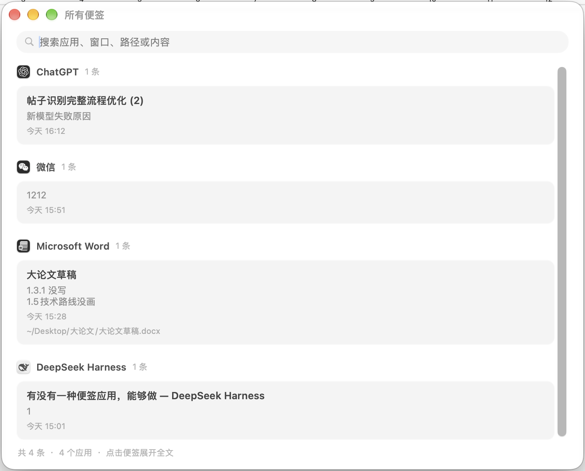
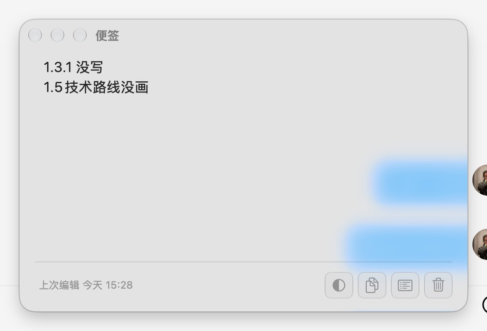
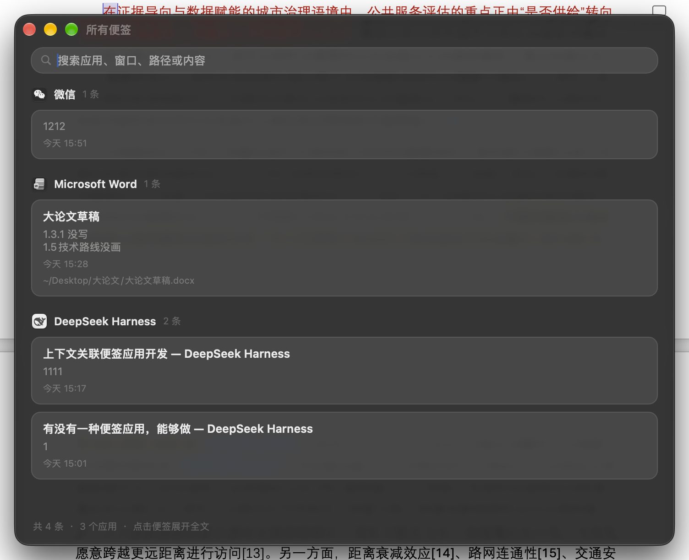

# ContextNotes · 语境便签

> 按 ⌥⌘N 在**任何程序、任何文档、任何网页**上随手记一条。
> 便签会自动记住"你在哪儿写的"，下次回到同一个地方，它就在那儿。

A macOS sticky-note utility that binds each note to the app, document, or web page
you were looking at when you wrote it. Summon it again in the same place and your
note is already there. ~1100 lines of Swift, no third-party dependencies, no Xcode
required.



<table>
<tr>
<td></td>
<td></td>
</tr>
<tr><td align="center">按 ⌥⌘N 呼出 · Liquid Glass 面板</td><td align="center">深色模式</td></tr>
</table>

## 快速开始

需要 macOS 13+ 和 Command Line Tools（`xcode-select --install`），不需要完整 Xcode。

```bash
git clone https://github.com/Timebro9999/ContextNotes.git
cd ContextNotes
./install.sh          # 构建 → 装到 /Applications → 注册登录自启 → 启动
```

首次启动必须授予**辅助功能**权限（系统设置 → 隐私与安全性 → 辅助功能），
否则无法识别你在哪个窗口里。详细步骤见[首次使用](#首次使用必须授权)。

| 快捷键 | 作用 |
|---|---|
| `⌥⌘N` | 在当前语境呼出便签 |
| `⇧⌥⌘N` | 总面板（按 App 分区） |
| `⌘↩` / `esc` | 保存并关闭 |

---

## 为什么这样做

这类工具唯一真正的难点是**锚点**——用什么来认定"同一个地方"。

本项目采用四层递降策略，命中越靠前越精确：

| 层级 | 来源 | 精确度 | 覆盖范围 |
|---|---|---|---|
| 1 | `AXDocument` | 精确到文件 | Word、Pages、预览、Xcode、Obsidian 等文档类应用 |
| 2 | 浏览器 URL | 精确到网页 | Safari / Chrome / Edge / Arc / Brave / Vivaldi / Opera |
| 3 | 窗口标题 | 精确到窗口 | 几乎所有 App |
| 4 | 仅应用 | 精确到 App | 兜底 |

任何一层拿不到就自动降级，不会报错，只是便签粒度变粗。

---

## 界面

呼出后就是一张纸，没有标题栏、没有地址、不显示位置——你写的就是"这个位置的那张便签"。


左下角一排圆点是七种纸色（柠檬黄 / 蜜桃橙 / 樱花粉 / 薄荷绿 / 天空蓝 / 薰衣草 / 素白）。
点一下立刻换色并落盘；新建便签时沿用上一次用过的颜色。


纸面是代码画的：上浅下深的渐变、顶部一条受光高光、极细的纸边描线。
窗口阴影交给系统按 alpha 形状生成，所以整张纸是透明的、无边框的。

实现要点：`PaperView` 是 flipped 坐标系；调色底条用 `PaletteBar.draw` 而不是
`layer.backgroundColor`，因为离屏渲染时 layer 背景可能不参与绘制。

### 数据结构的变化

从"每写一次追加一条日志"改成"**一个位置 = 一张纸**"：

- 同一位置反复呼出，改的是同一张纸，不会堆成一串
- 内容为空时不保存，避免误清空；要删请到总面板
- 旧的多条历史记录会在下次保存时合并成一张，创建时间保留最早那条
- 颜色存在 `Note.color`，旧数据没有该字段时按默认色处理

### 外观可调

底部左侧那个半圆按钮打开外观弹窗：

| 项 | 默认 | 说明 |
|---|---|---|
| **主题** | 随系统 | 随系统 / 浅色 / 深色。通过 `NSApp.appearance` 全局生效，两个窗口一起变 |
| **玻璃浓度** | 20% | 0–95%，0 完全通透，越高越接近不透明 |
| **风格** | 常规 | 对应 `NSGlassEffectView.style` 的 `.regular` / `.clear` |
| **圆角** | 0 | 0–28，玻璃自身的圆角半径 |

深色下玻璃的 tint 会从白翻成黑（`Palette.dynamic`）。

**只改 tintColor 不够黑。** `NSGlassEffectView` 会采样背后内容，
背后是白底文档时，20% 的黑色着色压不出深色——实测仍是中灰。
所以在玻璃的 `contentView` 里垫了一层 `ScrimView`：浅色透明、
深色 `black 0.55`，随主题自动切换。这是让它"真的黑"的关键。

改动即时生效并写入 `~/Library/Application Support/ContextNotes/appearance.json`，
下次启动自动读回。键盘也能调：`⌘[` 减淡、`⌘]` 加浓。

### 位置与大小记忆

关闭时记住窗口位置和尺寸，下次呼出回到原位。拖动/缩放后 0.6 秒防抖保存，
关闭时再存一次。外接屏拔掉导致旧坐标落在屏幕外时，自动退回居中。

## 图标与启动

| 入口 | 行为 |
|---|---|
| Dock 图标 | 点击即打开总面板（没有可见窗口时） |
| 菜单栏图标 | 点开是菜单：呼出便签 / 所有便签 / 权限 / 数据文件夹 / 退出 |
| `⌥⌘N` | 呼出当前语境便签 |
| `⇧⌥⌘N` | 总面板 |

图标由 `tools/make-appicon.swift` 用代码画出来（蓝色 squircle + 斜置白纸 + 三行字，
最后一行橙色作记忆点），生成 10 个尺寸后 `iconutil` 打包成 `Assets/AppIcon.icns`。
改设计后重跑：

```bash
swift tools/make-appicon.swift
iconutil -c icns Assets/AppIcon.iconset -o Assets/AppIcon.icns
./build.sh
```

菜单栏图标是 `AppDelegate.statusBarGlyph()` 运行时用贝塞尔曲线画的模板图，
`isTemplate = true`，所以深浅色菜单栏都自动适配。

### 图标跟随系统图标样式

三套图标，按系统的 `AppleIconAppearanceTheme` 选择：

| 图标样式 | 外观 | 图标 | 素材 |
|---|---|---|---|
| 默认 | 浅色 | 蓝色渐变底 + 白纸 + 橙色行 | `light` |
| 默认 | 深色 | **黑底 + 淡蓝单色字形** | `dark` |
| 透明 / 色调 | 浅色 | 极淡玻璃底 + 白纸 + 灰行 | `clearLight` |
| 透明 / 色调 | 深色 | **黑底 + 淡蓝单色字形** | `clearDark` |

两个要点：

1. **深浅只看 `AppleInterfaceStyle`**。`AppleIconAppearanceTheme` 里的 "Dark"
   （如 `ClearDark`）是样式名的一部分，切到浅色外观后它**仍然是 ClearDark**——
   拿它判断深浅会永远选深色版。踩过。
2. **无彩色模式不能留橙色**。系统深色图标是黑底 + 淡蓝单色字形（参照 Music、微信），
   留一个橙色行会显得脏。

`icns` 不支持外观变体，而 `actool`（Xcode 组件）在本机不可用，
所以走运行时替换：`NSApp.applicationIconImage`，选择依据来自

```swift
CFPreferencesCopyAppValue("AppleIconAppearanceTheme" as CFString,
                          kCFPreferencesAnyApplication)
```

刷新时机：启动、`NSApp.effectiveAppearance` 变化（KVO）、App 重新激活
（改完系统设置切回来就生效）。全程**无需重启**。

```bash
swift tools/make-appicon.swift   # 一次生成深浅两套 + 运行时大图
```

已知差异：Finder 里那个图标（App 未运行时）仍是 `.icns` 的浅色版，
因为那由 LaunchServices 按 bundle 读取，无法运行时干预。

**图标显示成灰的是正常的**：macOS 26 起的图标外观（默认 / 深色 / 透明 / 着色）
由系统统一处理，`icns` 里的文件本身是彩色的（可用 `sips` 或 `NSBitmapImageRep` 验证）。

状态栏项如果看不见，通常是菜单栏太挤被收进 `«` 折叠区。
按住 ⌘ 拖动图标可以调整顺序。

调试日志：`touch /tmp/contextnotes-debug` 后日志写到 `/tmp/contextnotes.log`。

## 快捷键


| 操作 | 快捷键 |
|---|---|
| 呼出当前语境便签 | `⌥⌘N` |
| 打开总面板 | `⇧⌥⌘N` |
| 保存并关闭 | `⌘↩` 或 `esc` |

也可以用命令行触发（调试和自动化用）：

```bash
./show.sh        # 便签面板
./show.sh all    # 总面板
```

原理是 Darwin 通知（`notifyutil -p com.aabananaaa.contextnotes.show`）。
注意必须用 Darwin 通知中心监听，`NSDistributedNotificationCenter` 走的是 distnoted，
收不到 `notifyutil` 的消息。

- 面板上方会显示当前语境（应用 · 窗口 / 文档路径 / 网页地址）
- 下方灰色区是**这个位置的历史记录**，如果同一程序其他位置也有记录，会折叠展示
- 输入框旁 `esc` 也会保存——不会丢东西

---

## 首次使用：必须授权

**没有权限它就是个废的**（拿不到窗口标题和文档路径，只能退化成按 App 分类）。

### 1. 辅助功能（必须）

系统设置 → 隐私与安全性 → 辅助功能 → 把 `ContextNotes` 加进去并勾选。

启动时 App 会自动弹窗引导，点"打开系统设置"即可。

### 2. 自动化（可选，仅浏览器需要）

第一次呼出浏览器里的便签时，系统会问"是否允许 ContextNotes 控制 Google Chrome"，点**允许**。

拒绝也能用，只是网页便签会降级成按窗口标题归类。

### 验证权限是否生效

```bash
~/日常使用/context-notes/ContextNotes.app/Contents/MacOS/ContextNotes --probe
```

正常输出应类似：

```
辅助功能权限: ✅ 已授权
应用:     Google Chrome
窗口标题: usememos/memos: ...
网页地址: https://github.com/usememos/memos
锚点 key: url:https://github.com/usememos/memos
```

---

## 安装

```bash
./install.sh
```

构建 → 安装到 `/Applications/ContextNotes.app` → 重挂登录自启 → 启动。
会自动删掉构建目录里的副本，避免同一个 bundle id 存在两份、LaunchServices 认错，
并归档旧的 ad-hoc 备份（防止它被当成第二个 App 注册）。

装好后：

- Dock 图标点击 → 打开总面板
- 菜单栏图标 → 功能菜单
- 登录后自动启动（LaunchAgent 指向 `/Applications`）

**换位置后辅助功能不用重新授权**：TCC 认的是证书身份
（`certificate root = H"38efdcb6..."`），不是路径。

## 数据在哪

```
~/Library/Application Support/ContextNotes/store.json
```

纯 JSON，明文可读，可直接编辑或备份。菜单栏图标 →「打开数据文件夹」直达。

---

## 开发

```bash
./build.sh              # 编译 + ad-hoc 签名
./install-login-item.sh # 注册为登录自启（LaunchAgent）
```

自检：

```bash
./ContextNotes.app/Contents/MacOS/ContextNotes --selftest   # 存储回路
./ContextNotes.app/Contents/MacOS/ContextNotes --probe      # 上下文识别
```

### 代码结构

| 文件 | 职责 |
|---|---|
| `Sources/Model.swift` | 数据结构、锚点 key 计算、JSON 存储 |
| `Sources/ContextCapture.swift` | 四层上下文识别（AX / AppleScript） |
| `Sources/NotePanel.swift` | 悬浮便签面板 |
| `Sources/MainWindow.swift` | 总面板（列表 + 搜索 + 详情） |
| `Sources/main.swift` | 状态栏、全局快捷键、权限引导 |

---

## 分发与上架

见 [docs/DISTRIBUTION.md](docs/DISTRIBUTION.md)：GitHub Releases（推荐，需 Developer ID + 公证）
与 Mac App Store（需沙盒，本项目的辅助功能依赖是主要障碍）的完整分析。

## 已知限制

1. **必须显式指定部署目标，否则系统直接拒绝这个 app**（踩过的坑，已修复）。
   Swift 6.x 工具链默认会把 Mach-O 的 `minos` 编成比本机更高的版本，
   LaunchServices 判定「无法在本机运行」后拒绝登记，症状是一组看起来毫无关联的报错：

   - `open ContextNotes.app` → `-10825`
   - `tccutil` → `-10814 Cannot find bundle identifier`
   - 系统设置里添加辅助功能 → app 图标显示 🚫

   `build.sh` 里已固定 `-target ${ARCH}-apple-macos13.0`。
   改动构建脚本时务必保留这一行。

2. **签名身份已固定，重编译不再掉权限**（已解决）。
   ad-hoc 签名的「指定要求」是 cdhash，每次编译都变，系统认为每次都是新程序，
   辅助功能授权随即失效。现改用本地自签名证书：

   ```
   旧: designated => cdhash H"0743977b..."
   新: designated => certificate root = H"38efdcb6..."
   ```

   DR 基于证书根，恒定不变，因此授权可跨重新编译保留。
   证书有效期至 2036 年，路径 `signing/`（私钥权限 600）。
   重建身份：`./make-signing-identity.sh`（幂等）。`build.sh` 会自动优先使用它，
   找不到时退回 ad-hoc 并给出警告。

   唯一代价：**换签名那次需要重新授权一次**，之后不再需要。

3. **Word 反而比预想的好**——实测 `Microsoft Word` 会为已保存的 `.docx` 提供
   `AXDocument`，能精确到文件路径。但**未保存的新建文档**拿不到，会退回窗口标题。
   WPS 未实测。

4. **网页改版 / URL 变化**会导致锚点漂移——这是所有网页标注工具的共性。

5. **热键是全局抢占**——如果某个 App 也用 `⌥⌘N`，会被本工具吃掉。改 `Sources/main.swift`
   里的 `kVK_ANSI_N` 即可。

6. **单实例、无云同步**——数据只在本机。要同步可把 `store.json` 放进 iCloud 目录并改
   `Store` 里的路径。

---

## 接下来可以加的

- [ ] 便签支持 Markdown 渲染与图片粘贴
- [ ] 总面板按 App 分组 / 标签
- [ ] 导出 Markdown
- [ ] 全局搜索（Spotlight 式 `⌥⌘F`）
- [ ] 自动保存草稿（按 Esc 已保存，但中途崩溃未保存）
- [ ] 锚点漂移检测：文档改名时提示"要不要把这些便签迁移到新路径"
